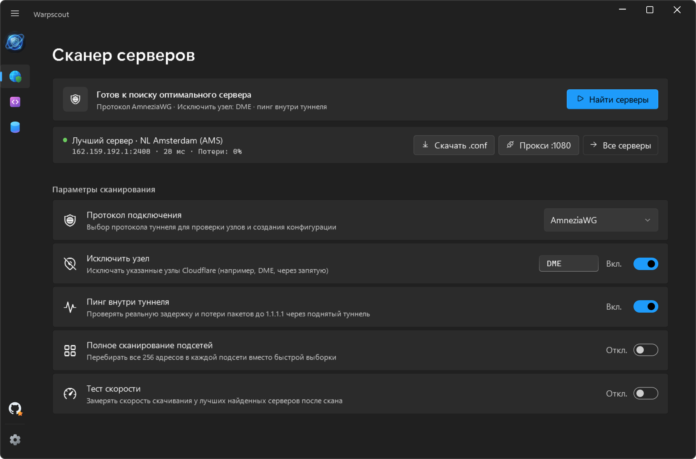

# Warpscout GUI Windows

**Нативное десктопное приложение для Windows 10/11 для сканера [warpscout](https://github.com/vernette/warpscout) на .NET 8 WPF + WPF-UI.**

[English Documentation](README_EN.md)

## Возможности

- **Нативный интерфейс Windows 10/11 (Fluent 2 / Mica):** системный фон Mica, тёмная тема Windows 11 и нативные контролы [WPF-UI](https://github.com/lepoco/wpfui).
- **Управление ядром `warpscout.exe`:**
  - Выбор файла ядра в **Настройках**.
  - При первом запуске приложение автоматически скачает актуальное ядро `warpscout.exe` из релизов [vernette/warpscout](https://github.com/vernette/warpscout).
- **Поиск серверов в 1 клик:** потоковая таблица для **AmneziaWG**, **AmneziaWG 3.1** (`padding`, тайминги, `random-trailers`, `disable-cookies`), **WireGuard**, **MASQUE** и **MASQUE H2** с замером пинга внутри туннеля.
- **Быстрые действия и трей:** скачивание готового `.conf` / `.json`, включение локального SOCKS5-прокси `127.0.0.1:1080`, сворачивание в системный трей и предупреждение при выходе с активным прокси (с запоминанием выбора).

## Скриншоты





## Установка

Скачайте подходящую сборку со страницы [Releases](https://github.com/HattabbI4/warpscout-gui/releases):

- **`warpscout-gui_<версия>_windows_amd64_standalone.exe`** — автономная версия со встроенными библиотеками .NET 8 (~66 МБ). Запускается сразу на любой Windows 10/11 (x64) без дополнительной настройки.
- **`warpscout-gui_<версия>_windows_amd64_lite.exe`** — облегчённая версия без встроенных библиотек (~6 МБ). Требует установленного [.NET 8 Desktop Runtime (x64)](https://dotnet.microsoft.com/en-us/download/dotnet/8.0).


## Сборка (Windows 10/11)

Требуется .NET 8 SDK.

```powershell
# Быстрая сборка одним exe (если на ПК установлен .NET 8 Desktop Runtime)
dotnet publish -c Release -r win-x64 --self-contained false -p:PublishSingleFile=true -o publish

# Полностью автономный exe (не требует установленного .NET 8 на целевом ПК)
dotnet publish -c Release -r win-x64 --self-contained true -p:PublishSingleFile=true -p:IncludeNativeLibrariesForSelfExtract=true -p:EnableCompressionInSingleFile=true -o publish
```
