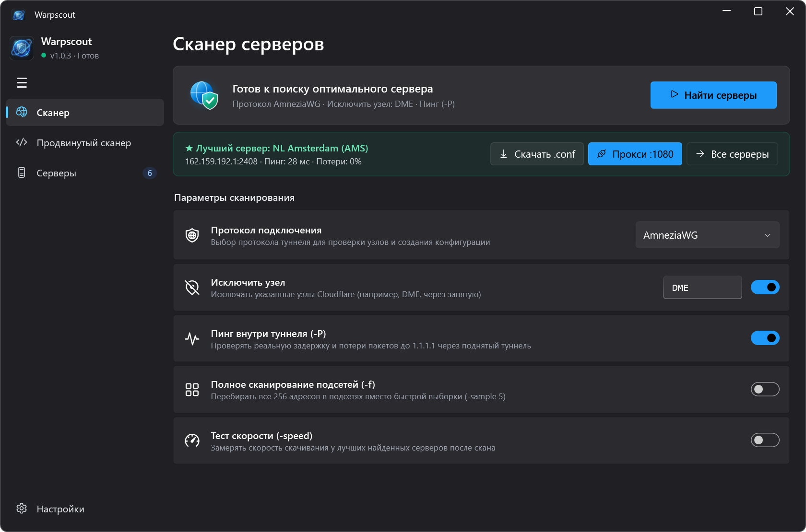
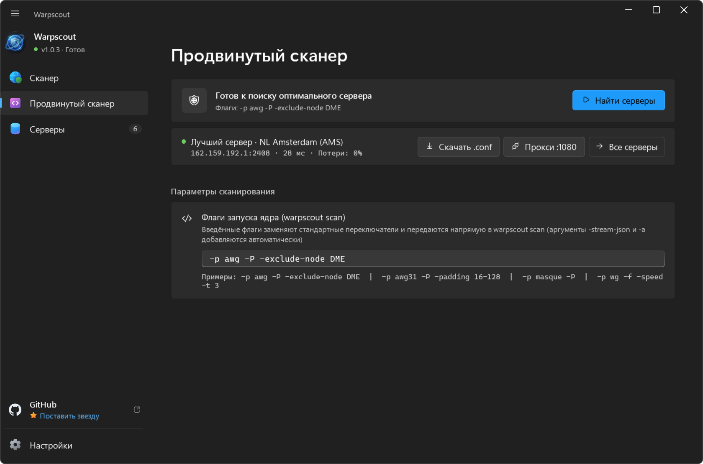
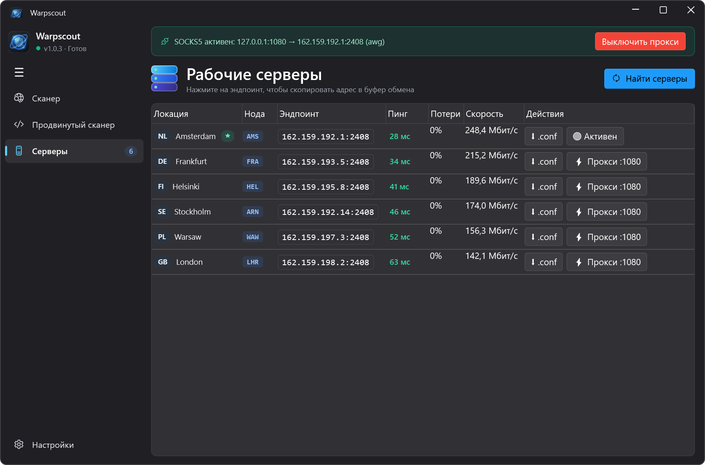
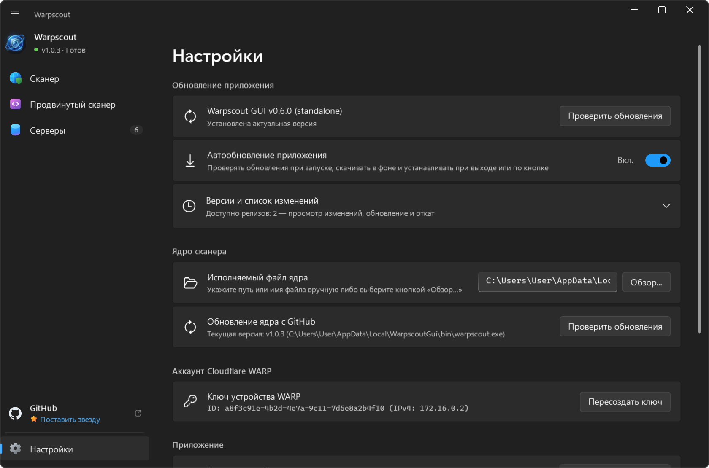

<div align="center">


<h1>Warpscout GUI</h1>

<p>Нативное десктопное приложение Windows 10/11 (Fluent 2 / Mica) для сканера <a href="https://github.com/vernette/warpscout">warpscout</a>.</p>

<p>
  <a href="https://github.com/HattabbI4/warpscout-gui/releases/latest"></a>
  <a href="https://github.com/HattabbI4/warpscout-gui/releases"></a>
  <a href="https://github.com/HattabbI4/warpscout-gui/actions/workflows/ci.yaml"></a>
  
  
  <a href="LICENSE"></a>
</p>

<p>
  <strong>Русский</strong> · <a href="README_EN.md">English</a>
</p>

</div>

---

**[Версия для macOS](https://github.com/HattabbI4/warpscout-gui-macos)**

## Возможности

- **Нативный интерфейс Windows 11 (Fluent 2 / Mica):** системный фон Mica, тёмная тема, сворачиваемое боковое меню и переключение языка интерфейса (`RU` / `EN`) на базе [WPF-UI](https://github.com/lepoco/wpfui).
- **Управление ядром `warpscout.exe` и аккаунтом WARP:**
  - Автоматическая загрузка и обновление `warpscout.exe` из релизов [vernette/warpscout](https://github.com/vernette/warpscout) при первом запуске.
  - Возможность указать собственный путь к исполняемому файлу в **Настройках**.
  - Автоматическая регистрация аккаунта Cloudflare WARP и пересоздание ключа устройства в 1 клик.
- **Сканер в 1 клик и продвинутый режим:**
  - Поддержка **AmneziaWG**, **AmneziaWG 3.1** (`padding`, тайминги рукопожатия, `random-trailers`, `disable-cookies`), **WireGuard**, **MASQUE (QUIC)** и **MASQUE H2 (TCP)**.
  - Исключение узлов Cloudflare (например, `DME`), замер реального пинга внутри туннеля (`-P`), полное сканирование подсетей (`-f`) и тест скорости (`-speed`).
  - Отдельная вкладка **Продвинутый сканер** для запуска `warpscout scan` с произвольными CLI-флагами.
- **Серверы, конфиги и локальный прокси:** потоковая таблица рабочих серверов с выделением лучшего эндпоинта, копирование адреса по клику, экспорт готовых `.conf` / `.json` конфигураций, встроенный локальный SOCKS5-прокси `127.0.0.1:1080`, сворачивание в системный трей и настраиваемое предупреждение при выходе с активным прокси.
- **Встроенное автообновление GUI:** проверка релизов на GitHub, фоновая загрузка с проверкой контрольной суммы SHA-256, просмотр списка изменений и откат на предыдущие версии (начиная с `v0.5.0`).

## Скриншоты

| Сканер серверов | Продвинутый сканер |
| :---: | :---: |
|  |  |

| Рабочие серверы и SOCKS5-прокси | Настройки и автообновление |
| :---: | :---: |
|  |  |

<details>
<summary>Сканер серверов со свёрнутым боковым меню</summary>


</details>

## Установка

Скачайте нужную сборку со страницы [Releases](https://github.com/HattabbI4/warpscout-gui/releases):

| Сборка | Файл | Размер | Требования |
| --- | --- | --- | --- |
| **Standalone** | `warpscout-gui_<версия>_windows_amd64_standalone.exe` | ~66 МБ | Windows 10/11 (x64), ничего устанавливать не нужно |
| **Lite** | `warpscout-gui_<версия>_windows_amd64_lite.exe` | ~6 МБ | Windows 10/11 (x64) + [.NET 8 Desktop Runtime (x64)](https://dotnet.microsoft.com/en-us/download/dotnet/8.0) |

> При первом запуске приложение автоматически загрузит актуальное ядро `warpscout.exe`. Встроенный менеджер обновлений позволяет обновлять саму оболочку и ядро прямо из вкладки **Настройки**.

## Сборка из исходников

Требуются Windows 10/11 и [.NET 8 SDK](https://dotnet.microsoft.com/en-us/download/dotnet/8.0).

```powershell
git clone https://github.com/HattabbI4/warpscout-gui.git
cd warpscout-gui

# Запуск модульных тестов
dotnet test WarpscoutGui.Tests/WarpscoutGui.Tests.csproj -c Release

# Облегчённый single-file exe (требует установленный .NET 8 Desktop Runtime)
dotnet publish -c Release -r win-x64 --self-contained false -p:PublishSingleFile=true -o publish

# Автономный single-file exe (не требует .NET 8 на целевом ПК)
dotnet publish -c Release -r win-x64 --self-contained true -p:PublishSingleFile=true -p:IncludeNativeLibrariesForSelfExtract=true -p:EnableCompressionInSingleFile=true -o publish
```

## Лицензия

Проект распространяется под лицензией MIT — подробности см. в файле [LICENSE](LICENSE).

## Credits

- [vernette/warpscout](https://github.com/vernette/warpscout) — CLI-ядро сканера WARP, генерация конфигов и локальный SOCKS5-прокси.
- [lepoco/wpfui](https://github.com/lepoco/wpfui) — библиотека WPF-UI для нативных компонентов Fluent Design 2 и эффекта Mica.
