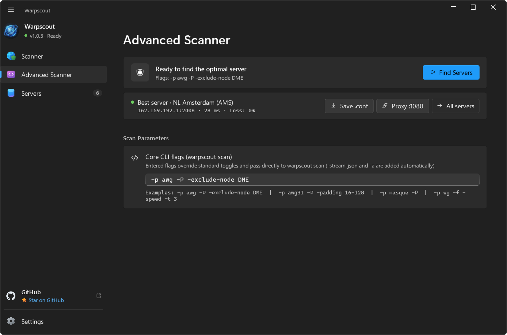

<div align="center">


<h1>Warpscout GUI</h1>

<p>A native Windows 10/11 desktop client (Fluent 2 / Mica) for the <a href="https://github.com/vernette/warpscout">warpscout</a> scanner.</p>

<p>
  <a href="https://github.com/HattabbI4/warpscout-gui/releases/latest"></a>
  <a href="https://github.com/HattabbI4/warpscout-gui/releases"></a>
  <a href="https://github.com/HattabbI4/warpscout-gui/actions/workflows/ci.yaml"></a>
  
  
  <a href="LICENSE"></a>
</p>

<p>
  <a href="README.md">Русский</a> · <strong>English</strong>
</p>

</div>

---

## Features

- **Native Windows 11 UI (Fluent 2 / Mica):** Windows 11 Mica backdrop, dark theme, collapsible sidebar, and instant `RU` / `EN` language switching powered by [WPF-UI](https://github.com/lepoco/wpfui).
- **`warpscout.exe` Core & WARP Account Management:**
  - Automatically downloads and updates `warpscout.exe` from [vernette/warpscout](https://github.com/vernette/warpscout) releases on first launch.
  - Supports overriding or picking a custom core binary path in **Settings**.
  - Automatic Cloudflare WARP account registration and one-click device key regeneration.
- **One-Click & Advanced Scanning:**
  - Supports **AmneziaWG**, **AmneziaWG 3.1** (`padding`, handshake timings, `random-trailers`, `disable-cookies`), **WireGuard**, **MASQUE (QUIC)**, and **MASQUE H2 (TCP)**.
  - Configurable Cloudflare node exclusion (e.g., `DME`), in-tunnel ping verification (`-P`), full subnet scanning (`-f`), and speed testing (`-speed`).
  - Dedicated **Advanced Scanner** tab for passing custom CLI flags directly to `warpscout scan`.
- **Servers, Config Export & Local Proxy:** Live-streaming endpoint table highlighting the best server, click-to-copy addresses, `.conf` / `.json` config export, built-in local SOCKS5 proxy on `127.0.0.1:1080`, system tray minimization, and configurable exit confirmation while the proxy is active.
- **Built-in App Auto-Updater:** Checks GitHub Releases for updates, downloads in the background with SHA-256 verification, displays localized release notes, and supports rollback to previous versions (`v0.5.0`+).

## Screenshots

| Server Scanner | Advanced Scanner |
| :---: | :---: |
|  |  |

| Working Servers & SOCKS5 Proxy | Settings & Updates |
| :---: | :---: |
|  |  |

<details>
<summary>Server Scanner with collapsed sidebar</summary>


</details>

## Installation

Download the build that fits your setup from [Releases](https://github.com/HattabbI4/warpscout-gui/releases):

| Build | Asset | Size | Requirements |
| --- | --- | --- | --- |
| **Standalone** | `warpscout-gui_<version>_windows_amd64_standalone.exe` | ~66 MB | Windows 10/11 (x64), zero prerequisites |
| **Lite** | `warpscout-gui_<version>_windows_amd64_lite.exe` | ~6 MB | Windows 10/11 (x64) + [.NET 8 Desktop Runtime (x64)](https://dotnet.microsoft.com/en-us/download/dotnet/8.0) |

> On first launch, the app automatically fetches the latest `warpscout.exe` core. Both the GUI and the core can be updated directly from **Settings**.

## Building from Source

Requires Windows 10/11 and the [.NET 8 SDK](https://dotnet.microsoft.com/en-us/download/dotnet/8.0).

```powershell
git clone https://github.com/HattabbI4/warpscout-gui.git
cd warpscout-gui

# Run unit tests
dotnet test WarpscoutGui.Tests/WarpscoutGui.Tests.csproj -c Release

# Framework-dependent single-file build (requires .NET 8 Desktop Runtime installed)
dotnet publish -c Release -r win-x64 --self-contained false -p:PublishSingleFile=true -o publish

# Self-contained single-file build (runs on any Windows 10/11 PC without .NET installed)
dotnet publish -c Release -r win-x64 --self-contained true -p:PublishSingleFile=true -p:IncludeNativeLibrariesForSelfExtract=true -p:EnableCompressionInSingleFile=true -o publish
```

## License

Licensed under the MIT License — see [LICENSE](LICENSE) for details.

## Credits

- [vernette/warpscout](https://github.com/vernette/warpscout) — CLI scanner core for WARP endpoint discovery, config export, and local SOCKS5 proxying.
- [lepoco/wpfui](https://github.com/lepoco/wpfui) — WPF-UI library providing Windows 11 Fluent Design 2 controls and Mica backdrop support.
