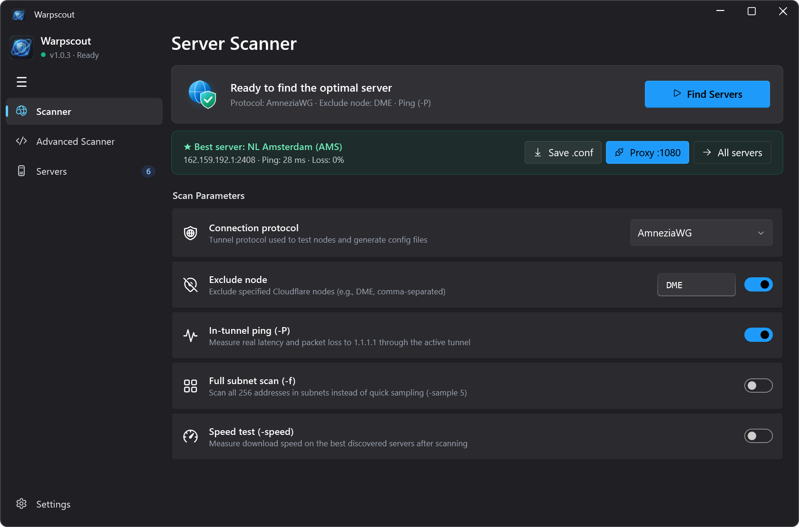
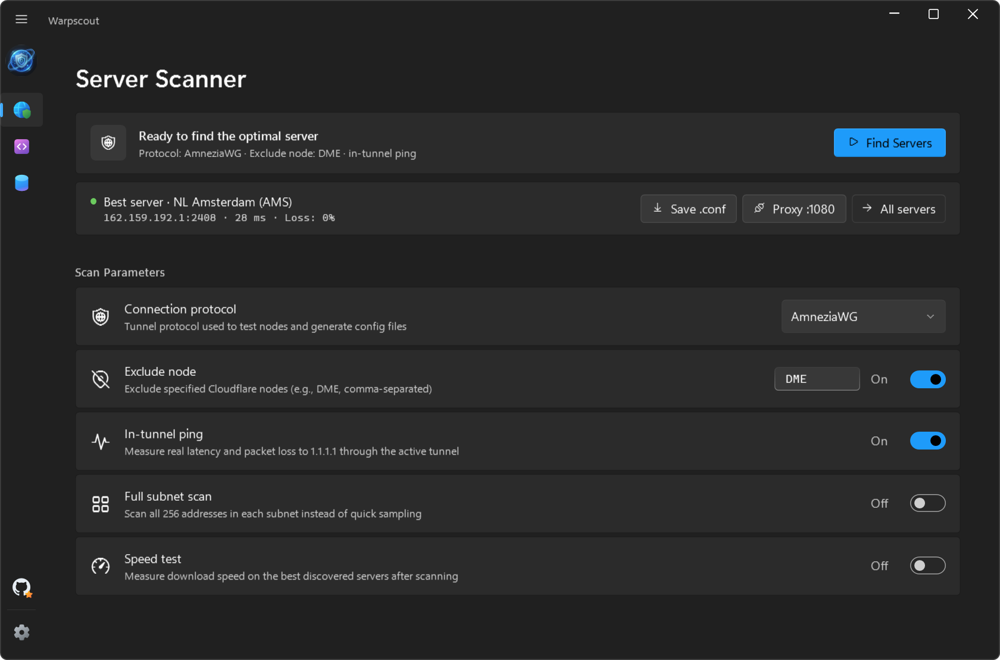
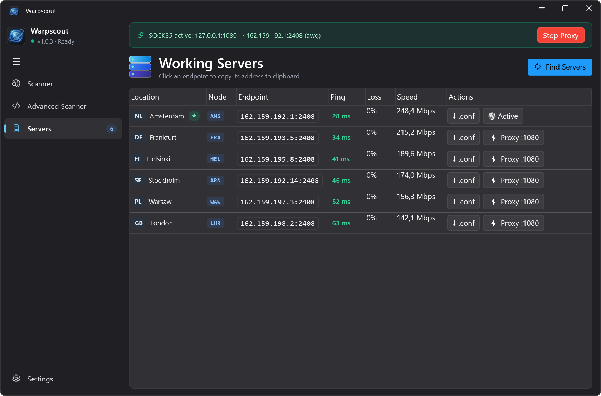
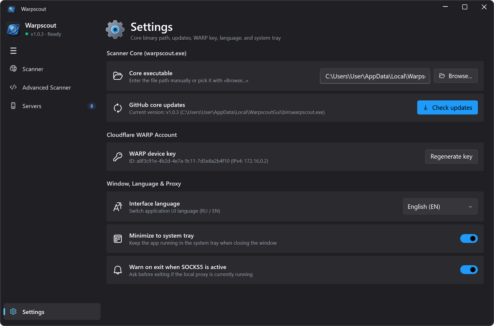

# Warpscout GUI for Windows

**A native Windows 10/11 desktop client for the [warpscout](https://github.com/vernette/warpscout) scanner, built with .NET 8 WPF and WPF-UI.**

[Русская документация](README.md)

## Features

- **Native Windows 10/11 UI (Fluent 2 / Mica):** Windows 11 Mica backdrop, dark theme, and native controls powered by [WPF-UI](https://github.com/lepoco/wpfui).
- **`warpscout.exe` Core Management:**
  - Pick or override the core executable path right in **Settings**.
  - On first launch, the app automatically fetches the latest `warpscout.exe` binary from [vernette/warpscout](https://github.com/vernette/warpscout) releases.
- **One-Click Server Discovery:** Live-streaming endpoint table for **AmneziaWG**, **WireGuard**, **MASQUE**, and **MASQUE H2**, complete with in-tunnel latency checks.
- **Quick Actions & System Tray:** Export ready-to-use `.conf` / `.json` configs, toggle a local SOCKS5 proxy on `127.0.0.1:1080`, minimize to the system tray, and confirm exit when the proxy is active (with an option to remember your choice).

## Screenshots









## Installation

Grab the right build from the [Releases](https://github.com/HattabbI4/warpscout-gui/releases) page:

- **`warpscout-gui_<version>_windows_amd64_standalone.exe`** — self-contained build bundled with the .NET 8 runtime (~66 MB). Runs out of the box on any Windows 10/11 (x64) machine with zero prerequisites.
- **`warpscout-gui_<version>_windows_amd64_lite.exe`** — framework-dependent build (~6 MB). Requires the [.NET 8 Desktop Runtime (x64)](https://dotnet.microsoft.com/en-us/download/dotnet/8.0) installed on your system.

## Building from Source (Windows 10/11)

Requires the .NET 8 SDK.

```powershell
# Framework-dependent single-file build (requires .NET 8 Desktop Runtime installed)
dotnet publish -c Release -r win-x64 --self-contained false -p:PublishSingleFile=true -o publish

# Self-contained single-file build (runs on any Windows 10/11 PC without .NET installed)
dotnet publish -c Release -r win-x64 --self-contained true -p:PublishSingleFile=true -p:IncludeNativeLibrariesForSelfExtract=true -p:EnableCompressionInSingleFile=true -o publish
```
